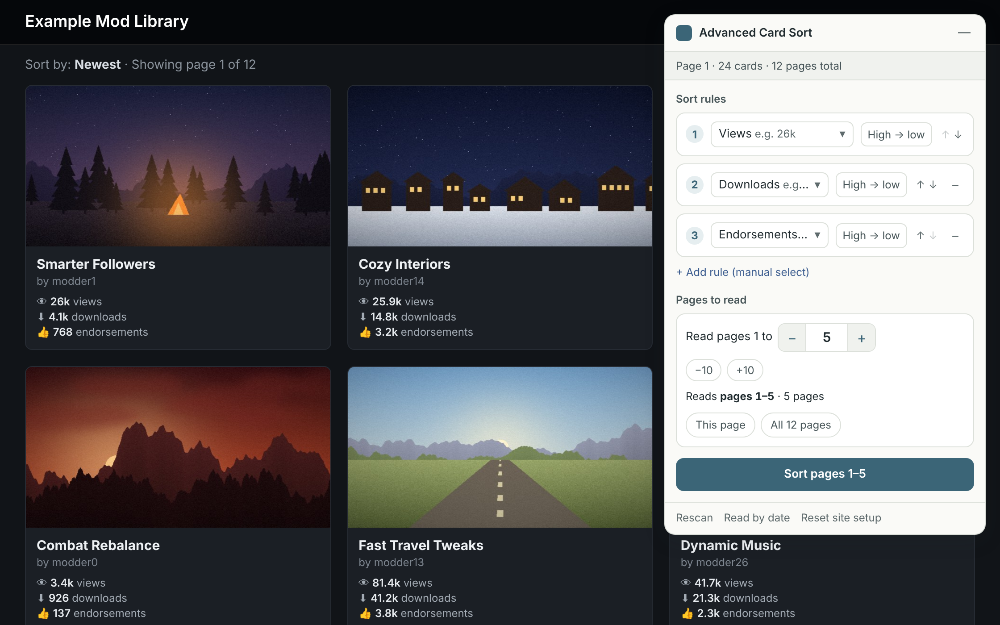
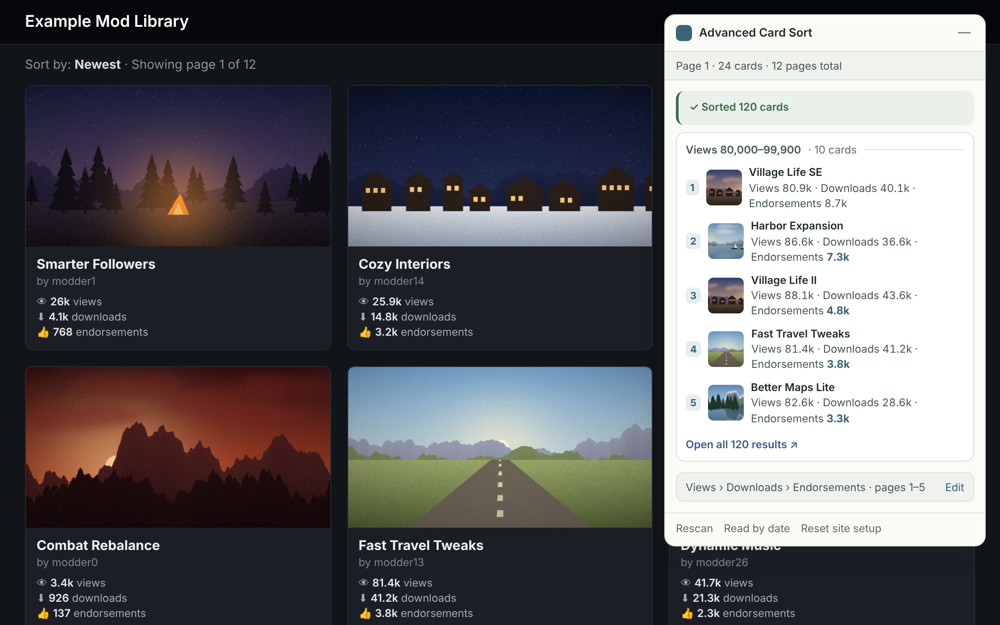

# Advanced Card Sort

**Sort by multiple criteria with custom priorities.**

Advanced Card Sort is a Chrome extension that uses multiple metrics—such as views, likes, and comments—**together** to sort webpage cards. You choose the metrics and their order of priority.

**One metric doesn’t tell the whole story.** High view counts don’t necessarily mean people liked something, and lots of comments may reflect controversy rather than appreciation. Considering multiple metrics helps you find content that better matches your preferences.

**Chrome Web Store: To be added**

| Set your sorting priorities | Explore the sorted results |
|---|---|
|  |  |

## Features

- **Use multiple metrics together.** Choose your metrics, arrange their priorities, and set each to sort from high to low or low to high.
- **Detect sortable numbers automatically.** Use values displayed on cards, including views, likes, downloads, ratings, prices, and file sizes.
- **Add metrics manually.** If automatic detection misses a number, select it on a card to try adding it as a sorting metric.
- **Read across pages.** Collect and sort cards from a selected page range on supported sites, up to 100 pages per run.
- **Reuse your setup.** Site settings and your last ten result sets are saved locally in your browser.

The interface supports English and Chinese.

## Where it works

Advanced Card Sort is designed for pages like those in the screenshots: each item appears in its own card, with numbers such as views, downloads, or likes. Examples include video galleries, mod catalogues, and downloadable asset libraries.

Sites with numbered page links work best for reading across multiple pages. Support depends on how the website loads and displays its content:

- **Dynamically loaded content:** some sites may only allow cards from the current page to be read.
- **Infinite scrolling:** only cards already loaded on the page can be sorted.
- **Numbers shown only on detail pages:** these are unavailable for sorting; the numbers need to appear on the cards.
- **Tables and plain text lists:** these are outside the extension’s intended scope.

Selecting a page range sets what the extension attempts to read. A website’s structure or access restrictions may prevent some pages from being collected.

## Installation

### Chrome Web Store

To be added.

### Install from source

1. Download and extract the project, or clone the repository.
2. Open `chrome://extensions` in Chrome.
3. Turn on **Developer mode**.
4. Click **Load unpacked**.
5. Select the extension folder containing `manifest.json`.

After updating the source files, click **Reload** on the extension’s entry in Chrome.

## Permissions and local data

Advanced Card Sort requests website access to read cards and the numbers displayed on them. It also uses browser permissions to open the panel, read additional pages, and display results.

Site settings and your last ten result sets are stored locally in your browser.

## Frequently asked questions

**Why can’t I find a number in the available metrics?**

Automatic detection may miss it. Try selecting the number manually from a card. Numbers available only after opening an item’s detail page cannot be used.

**Why are fewer pages included than I selected?**

The website’s loading method, pagination, or access restrictions may prevent some pages from being read. Each run is also limited to 100 pages.

**Does sorting remove cards?**

Sorting changes the order of the collected cards. Duplicate entries are merged. If you use a date range, only cards within that range are collected.

**Can I export the results?**

Data export is not currently supported.

## Report a problem

Found a problem? Report it on [GitHub Issues](https://github.com/JB-designer/Sorter-plugin/issues).

## License

Source code is licensed under MIT. See [`LICENSE`](LICENSE) for details.

---

# 多级排序 — 多属性网页卡片排序

**结合多个指标，按你设定的优先顺序排序。**

多级排序是一款 Chrome 扩展，可以结合观看量、点赞量、评论量等多个指标，对网页卡片进行排序。使用哪些指标、指标之间谁先谁后，都由你决定。

**单个指标不能说明全部。** 观看量高，不一定代表大家喜欢；评论多，也可能只是争议大。结合多个指标，能帮助你找到更符合自己偏好的内容。

**Chrome 应用商店：待添加**

| 设置排序指标与优先顺序 | 查看排序结果 |
|---|---|
|  |  |

## 主要功能

- **结合多个指标排序**：选择指标、排列优先顺序，并分别设置从高到低或从低到高。
- **自动识别可排序的数字**：包括卡片上的观看量、点赞量、下载量、评分、价格和文件大小等。
- **手动补充指标**：自动识别遗漏时，可以在卡片上点选对应数字，尝试将其添加为排序指标。
- **跨页读取**：在支持的网站上选择页面范围，将收集到的卡片汇总排序，每次最多读取 100 页。
- **复用网站设置**：记住你在各网站上的设置，并在浏览器本地保存最近十次排序结果。

界面支持中文和英文。

## 适用范围

多级排序适用于截图中这类页面：每项内容以独立卡片展示，卡片上带有观看量、下载量、点赞量等数字。例如视频页面、模组目录和素材下载页面。

跨页读取通常更适合带有页码链接的网站。实际支持情况取决于网站加载和展示内容的方式：

- **动态加载内容的网页**：部分网站可能只能读取当前页的卡片。
- **无限滚动的网页**：只能对已经加载的卡片排序。
- **仅在详情页显示的数字**：无法用于排序，数字需要出现在卡片上。
- **表格和纯文字列表**：不属于本扩展的主要适用范围。

你选择的页面范围，是扩展尝试读取的范围。网站结构或访问限制可能导致部分页面无法读取。

## 安装

### Chrome 应用商店

待添加。

### 从源码安装

1. 下载并解压项目，或克隆仓库。
2. 在 Chrome 地址栏输入 `chrome://extensions`。
3. 打开**开发者模式**。
4. 点击**加载已解压的扩展程序**。
5. 选择包含 `manifest.json` 的扩展文件夹。

更新源码后，在 Chrome 扩展管理页面点击该扩展的**重新加载**按钮。

## 权限与本地数据

多级排序需要网站访问权限，才能读取卡片及其显示的数字。相关浏览器权限也用于打开面板、读取后续页面和展示结果。

各网站的设置和最近十次排序结果保存在你的浏览器本地。

## 常见问题

**为什么可选指标里没有我想用的数字？**

自动识别可能遗漏部分数字。你可以尝试在卡片上手动点选。只有打开详情页后才能看到的数字，无法用于排序。

**为什么实际读取的页面比我选择的少？**

网站的内容加载方式、翻页方式或访问限制，可能导致部分页面无法读取。每次读取也有 100 页的上限。

**排序会减少卡片吗？**

排序会调整已收集卡片的顺序，重复项会合并。如果使用日期范围，则只收集该范围内的卡片。

**可以导出结果吗？**

目前不支持数据导出。

## 反馈问题

发现问题？欢迎通过 [GitHub Issues](https://github.com/JB-designer/Sorter-plugin/issues) 反馈。

## 许可证

源代码采用 MIT 许可证，详情见 [`LICENSE`](LICENSE)。
